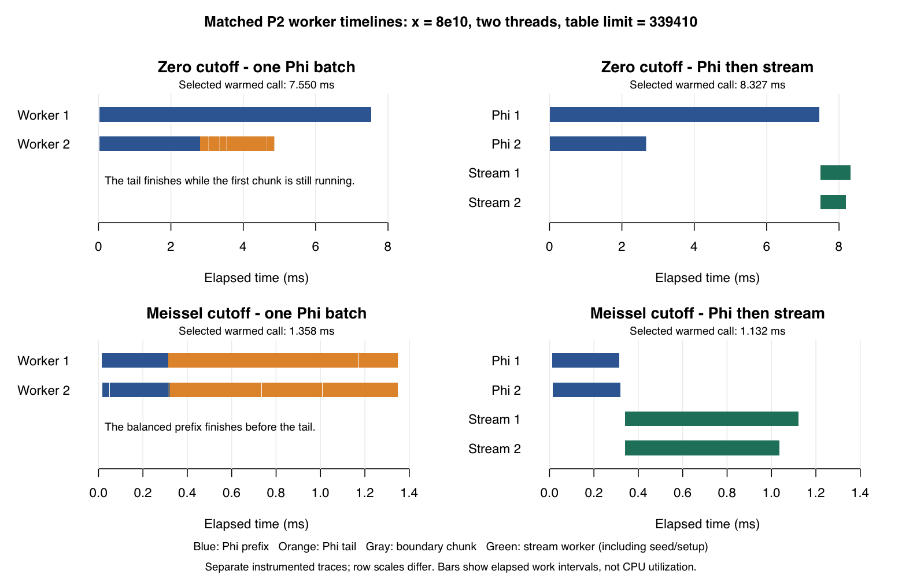

# P2 streaming and scheduling: retained findings

`src/P2.cpp` implements the accepted hybrid policy. It divides the P2 sum into
an early Phi range, a bounded segmented-counting range, and a direct pi-table
suffix. This note preserves the reasons for that design, its measured costs,
and the checks worth rerunning. The older v1/v2/v3 and fixed-cap variants are
historical experiments, not alternative production policies.

## Current policy

Let `L` be the prepared pi-table limit, usually `floor(sqrt(x))`. It is a numeric
limit, not a number of primes. The proposed maximum streamed quotient is:

| Input | Cap |
| --- | --- |
| `x < 1e11` | `8L` serial; `16L` with more than one useful Phi worker |
| `1e11 <= x < 3e12` | `16L`; `32L` when `x >= 1e12` and the Phi budget is at least four |
| `3e12 <= x < 3e13` | `32L` |
| `x >= 3e13` | `64L` |

The cap is clipped to the largest actual quotient. Empty/singleton non-table
ranges stay on Phi. A complete non-table range spanning at most 131,072 integer
positions may stream before the remaining guards. Otherwise, both the original
range and proposed stream must contain at least 4,096 queries. For `x < 1e11`
with parallel Phi, streaming also requires a sufficient stream-worker budget,
`L == floor(sqrt(x))`, and a first remaining prime greater than
`floor(x^(1/4))`. Enlarged tables and earlier cutoffs conservatively retain Phi.

The stream-worker grain is 1,048,576 integer positions. Phi starts from the full
non-table range's budget (one worker per 2,048 terms), then caps launches by
actual jobs. Its first 32 queries are individual jobs; subsequent jobs contain
up to 32 queries. One queue covers both parts, without an intervening barrier.
There is still a barrier between the complete Phi prefix and the stream.

These constants are empirical policies, not mathematical crossover bounds.
Correctness instead follows from the P2 identity and exact disjoint partition:
`floor(x/p) <= Q` exactly when `p > floor(x/(Q+1))`. Each streaming band starts
with an exact prime count; adjacent query ranges cannot omit or double-count a
term. Each work ticket likewise covers one disjoint part of its input range.

## Why change scheduling as well as the sieve?

A matched study at `x = 8e10`, two threads and `L = 339410` compared zero and
Meissel cutoffs with the same 19,161-query tail. In the old 32-query scheduler,
every zero-cutoff tail finished before the first expensive chunk in all 30
observed traces. Streaming only after that chunk exposed work previously hidden
behind it. The Meissel prefix was much lighter and balanced well.

The old hybrid changed warmed whole-call time by +9.89% at zero cutoff but
-18.41% at the Meissel cutoff. Warmed common-tail Phi cache counters were
identical and had no misses, so different software-cache misses did not explain
that reversal. Hardware-cache effects were not measured. Giving the first 32
queries separate jobs addressed the demonstrated imbalance without a new pool,
barrier, or runtime calibration. It does not guarantee perfectly balanced work.

The plotted traces illustrate the old scheduler and are diagnostic timings,
not the source of the uninstrumented performance comparisons. Their selected
rows remain in [plot-traces.csv](results-matched-profile/plot-traces.csv).

## Final comparison and tradeoffs

The accepted candidate was frozen before a 45-configuration focused cohort and
28-configuration held-out cohort. All controls used the new initial scheduling
except the original Phi-only baseline. Each fresh process supplied one first
and three warmed calls; there were five randomized matched blocks below `1e13`
and three above it. First and warmed calls were analyzed separately. All 12,104
results from 3,026 processes matched their expected values; no samples were
removed. The platform was macOS arm64 with Apple Clang 17 and C++11 `-O3`.

Representative complete native warmed totals (milliseconds):

| Cohort | x | Method | Threads | Old Phi-only | Candidate | Paired change |
| --- | ---: | --- | ---: | ---: | ---: | ---: |
| Focus | `1e12` | Meissel | 8 | 12.237 | 10.175 | -18.21% |
| Focus | `1e12` | Lehmer | 8 | 11.994 | 9.988 | -16.27% |
| Focus | `1e14` | Meissel | 8 | 618.226 | 325.777 | -47.07% |
| Focus | `1e14` | Lehmer | 8 | 602.999 | 309.025 | -48.36% |
| Held out | `8e13` | Meissel | 6 | 568.552 | 308.136 | -45.80% |
| Held out | `8e13` | Lehmer | 6 | 559.999 | 291.502 | -46.14% |

Percentages are medians of paired block ratios, not ratios of displayed medians.
First calls also improved in those examples. The main retained regression was
isolated P2 at `1e10`, Lehmer cutoff and eight requested threads: first calls
were 6.76% / 0.079 ms slower in every block. At `1e10`, eight-thread complete
warmed Lehmer was 1.80% / 0.011 ms slower. Conservative fallbacks also miss some
useful streams, particularly with slightly enlarged tables; the selector is
not the fastest hindsight choice for every input.

The largest recorded stream/subtotal vector capacity was 396,344 bytes, versus
45,316,764 bytes for prepared tables. These are component capacities, **not peak
RSS**; they exclude Phi cache pages, allocator overhead and thread stacks.
The dense-table limitation remains. Timings support this policy on the tested
machine, not a universal guarantee for other hardware or compiler settings.

## Evidence and current checks

- [Focused raw timings](results-consolidated/focus.csv.gz),
  [held-out raw timings](results-consolidated/holdout.csv.gz),
  [case definitions](results-consolidated/suite.json),
  [expected counts/provenance](results-consolidated/expectations.json),
  [allocation probes](results-consolidated/memory.csv), and
  [build/methodology/digests](results-consolidated/provenance.json) retain the
  final comparison. `python3 .github/development/p2-hybrid/summarize.py` checks
  these inputs and prints candidate-versus-baseline first/warmed summaries.
- The [independent saved terms](results-matched-profile/reference-terms.csv.gz)
  remain available for the matched-cutoff references used by the R tests.
- `python3 .github/development/p2-hybrid/production-integration/validate.py /tmp/p2-check`
  builds the **current** production source under ASan/UBSan and TSan. It checks
  independent small factorization/prime counts, a larger Phi-only differential
  reference, concurrent calls, private stream windows, queue coverage through
  `INT64_MAX`, selector boundaries, and actual worker launches. Its three small
  frozen fixtures are described in [fixtures/README.md](fixtures/README.md).
  The output's `native-validation/` directory must not already exist.

The production cleanup previously passed 60,322 common checks, 71,120 queue
checks, 15,013 selector comparisons, 739 worker-budget/launch checks and 88
private stream checks per sanitizer. These are scoped regression checks, not a
full package or cross-platform certification. See [testing.md](../testing.md)
for R tests and other retained harnesses.

The original studies, scripts and detailed records are recoverable from commit
`36303eb268288a2449e348ba6d5b911ffb2fac51`, under the same `p2-hybrid/` and `p2-profile/` paths. This
consolidation removes intermediate replays and generated reports from the live
tree; it does not reinterpret their baselines as today's implementation.
