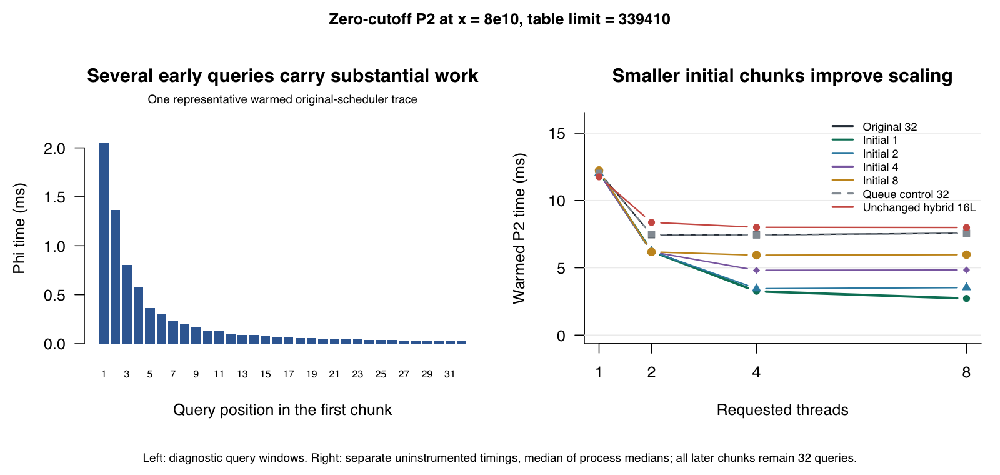

# Temporary smaller initial chunks in P2

Dividing the first 32 queries into smaller jobs removes much of the measured
zero-cutoff scheduling bottleneck. At `8e10`, one-query initial chunks reduce
warmed P2 time by about 16%, 56% and 64% with two, four and eight workers.
Meissel and Lehmer cutoffs show no general scheduling gain, and some first
calls regress. This is a useful improvement for the heavy-prefix workloads,
not a universal speedup or a substitute for the streaming investigation.

Production remains unchanged at `8b43ed790435b22eb9ec02627379082fe7deb103`.
All variants live outside the package build. Existing hybrid/selector kernels,
policies and earlier result files are preserved. No production rule is selected
or committed by this study.

## What changes

The baseline assigns contiguous 32-query chunks from one atomic counter. The
four temporary variants divide just the **first 32 non-table queries** into
jobs of size 1, 2, 4 or 8. Every later job still contains up to 32 queries.
The initial indices are `a+1` through `a+32`, not necessarily prime indices
1 through 32. Final jobs are clipped to the actual interval.

One atomic ticket queue covers both portions. For an interval of length `n`,
let `h = min(32,n)` and `m = ceil(h/K)`. Tickets below `m` cover consecutive
K-sized pieces of the first `h` terms; later tickets start at offset `h` and
cover consecutive 32-sized pieces. These intervals are disjoint, meet at `h`,
and cover the original range exactly. Atomic ticket assignment gives each job
one owner. A worker can claim a later job while another is still executing an
early one: there is **no intermediate completion barrier**.

The generated copy preserves the query formula, Phi evaluator/cache, table
lookups, worker budget, serial return path, result reduction, and ThreadBatch
exception handling. The queue adds no allocations or workers. At most 31 extra
successful claims are introduced, for K=1. All valid offsets stay below the
interval length; ticket bounds are checked before multiplication, including
the allocation-free `INT64_MAX` queue tests.

Seven builds are compared:

- Original production P2, with its original counter.
- `head1`, `head2`, `head4`, `head8`: the four initial chunk sizes.
- `head32`: the same ticket machinery with the original mathematical chunks,
  to separate mapping/code-layout effects from finer granularity.
- The **unchanged fixed16 hybrid**, as a separate strategy control.

The hybrid receives no smaller-chunk modification in this experiment. There
is no thread pool, nested parallelism, new dependency or language-standard
change. The native code remains C++11.

## First-query profile

Separate diagnostics retain the original scheduler and time only the Phi
calculation for the first 32 queries. They also record the first 64 chunk
windows and every worker's lifetime and work totals. Quotient/root calculation
is outside each query window. Probe timestamps perturb execution and are not
used as the variant performance measurements.

For the matched zero cutoff at `8e10`, two threads and `L=339410`, the warmed
first-32 Phi windows total about **7.404 ms**. The first query takes about
**2.035 ms**. Per-call ratios, aggregated through process medians, give:

| Portion of the first 32 queries | Share of their warmed Phi time |
| --- | ---: |
| First query | 27.64% |
| First four | 64.66% |
| First eight | 79.42% |

Thus several early queries carry substantial work. One query does not consume
the entire chunk, but K=4 or K=8 still groups much of its costly work into one
job. The eight-thread original-scheduler trace gives nearly the same shares.
The first-query share for matched warmed Meissel/Lehmer is only about 5–6% of
their own first-32 windows, with much less skew.

At `1e14` and eight threads, the first-32 window occupies only about 0.48% of
Meissel P2 elapsed time and 5.83% of Lehmer P2 elapsed time in these traces.
That limits expectations for this narrowly targeted change. These elapsed
work shares are not counterfactual speedup predictions: cache sharing and
per-query costs can change when scheduling changes, especially on first calls.
In the serial probe, the one recorded chunk spans the whole interval, so its
chunk duration must not be mistaken for a first-32 duration.



The left panel selects a warmed query trace nearest the median process and
then nearest that process's median first-32 time. The right panel comes from
the separate uninstrumented comparison. The serial path bypasses the queue in
all initial-chunk builds; serial differences cannot demonstrate a granularity
benefit. Hybrid stream workers can be fewer than the requested thread budget.

## Benchmark design

The frozen matrix has 56 configurations: 36 isolated P2 and 20 complete native
Meissel/Lehmer formulas.

| Workload | Inputs and cutoffs | Requested threads |
| --- | --- | --- |
| Matched isolated P2, 6/5 root table | `8e10`: zero, Meissel, Lehmer | 1, 2, 4, 8 |
| Isolated P2, root tables | `1e10`, `1e12`: Meissel, Lehmer | 1, 2, 4, 8 |
| Additional zero-cutoff controls | `1e10`, `1e12` | 2, 8 |
| Large isolated P2, root tables | `1e14`: Meissel, Lehmer | 1, 8 |
| Complete Meissel and Lehmer | `1e10`, `1e12` | 1, 2, 4, 8 |
| Large complete Meissel and Lehmer | `1e14` | 1, 8 |

Cases below `1e14` use five randomized blocks with one first and five warmed
calls per fresh variant process. The `1e14` cohort was predefined to use three
blocks with one first and three warmed calls to bound runtime. There are
**10,752 timed results from 1,848 fresh processes**. The timing matrix took
about 958 seconds; compilation, sanitizer checks, query profiling and analysis
ran separately. No additional local benchmark/validation workloads competed
with it. No samples were discarded or policy constants retuned.

Isolated P2 timing excludes table setup and reuses the prepared table. Complete
timings sum setup, Phi, P2, P3 when applicable, and teardown, excluding R and
post-call diagnostics. Complete calls rebuild tables but retain the shared
Phi cache. Their main Phi phase precedes P2 even on the first call, so their
cache histories differ from isolated first P2 calls.

Warmed calls are reduced to a median within each process; reported aggregate
times are medians of those process values. Percentage changes pair processes
within the same case/block. They need not equal ratios of displayed aggregate
medians. Ranges describe the collected blocks, not confidence intervals.
Across-case summaries are unweighted descriptions of this focused matrix.
Actual P2 worker counts are retained separately: for example, requested eight
at `1e10` can be capped at four by the existing grain rule.

## Zero-cutoff results

At `8e10` and the 6/5-sized table, warmed times are:

| Requested/actual Phi workers | Original | K=1 | K=2 | K=4 | K=8 | K=32 control | Hybrid16 |
| --- | ---: | ---: | ---: | ---: | ---: | ---: | ---: |
| 2 | 7.452 | 6.218 | 6.227 | 6.185 | 6.179 | 7.481 | 8.370 |
| 4 | 7.448 | 3.255 | 3.449 | 4.812 | 5.936 | 7.438 | 8.008 |
| 8 | 7.567 | 2.721 | 3.533 | 4.836 | 5.973 | 7.555 | 7.991 |

All values are milliseconds. K=1's paired warmed reductions relative to
production are **16.00%, 56.39% and 64.24%**, respectively. K=1 and K=2 are
effectively similar at two workers. At four/eight, K=1 beats K=2 in every block,
by 5.87% and 22.99% at the paired medians. The 32-query mapping control stays
near production, so the large gains survive that control.

First calls improve too:

| Workers | Original first ms | K=1 first ms | K=32 first ms |
| --- | ---: | ---: | ---: |
| 2 | 20.559 | 16.734 | 20.430 |
| 4 | 18.765 | 8.595 | 18.254 |
| 8 | 19.701 | 8.370 | 19.474 |

Every smaller initial size improves **all seven parallel zero-cutoff cases in
every collected block**, both first and warmed. K=1's case-level paired
reductions span 16.26–63.57% first and 16.00–64.24% warmed. The additional
root-table `1e10` and `1e12` eight-requested-thread cases improve warmed by
58.99% and 60.45%, respectively; the former actually uses four P2 workers.

This particularly benefits the general zero-cutoff P2 workload used by
`semiPrimeCount(n, a=0)`. It does not imply that complete Meissel/Lehmer calls
will gain the same amount, since their P2 cutoffs omit those earliest primes.

## Meissel/Lehmer results and regressions

There is no general scheduling improvement for these cutoffs. Most warmed
isolated differences are small. Across the parallel isolated cases, median
case changes for K=1 are +1.00% for Meissel and +0.83% for Lehmer; K=2 gives
-0.05% and +0.64%. These are descriptions of the targeted cases, not a predicted
overall overhead. Serial and K=32 controls also vary.

One clearer unfavorable result must remain visible: isolated Lehmer at `1e10`,
requested eight/actual four workers, first calls. K=1 takes 1.261 ms versus
1.165 ms production and 1.183 ms K=32. Its paired change is **+8.50% versus
production** and **+6.03% versus K=32**, with all five K=32 comparisons slower
(+3.23 to +18.12%). The study does not isolate whether cold cache-sharing,
scheduling overhead, or another execution interaction causes that penalty.

Complete eight-thread warmed results illustrate the limits of this change:

| Input | Method | Original ms | K=1 ms | K=32 ms | Unchanged hybrid16 ms |
| --- | --- | ---: | ---: | ---: | ---: |
| `1e12` | Meissel | 12.421 | 12.581 | 12.441 | 10.423 |
| `1e12` | Lehmer | 11.807 | 11.700 | 11.740 | 9.981 |
| `1e14` | Meissel | 567.939 | 615.219 | 617.936 | 358.315 |
| `1e14` | Lehmer | 611.714 | 609.092 | 598.988 | 368.015 |

K=1's paired complete changes at `1e12` are +0.35% Meissel and -0.54% Lehmer;
at `1e14` they are +11.23% and -0.43%. The large Meissel observation is not a
clean estimate of the smaller-chunk effect: K=32 also regresses 8.80%, and both
the unchanged Phi phase and the P2 phase vary substantially. K=1 versus K=32
is +2.23% warmed with mixed blocks (-2.61 to +4.83%). Its first-call P2 phase
versus K=32 is +9.30%, with all three blocks slower, while the complete first
comparison is mixed. Retain the adverse observations; their full attribution
remains unresolved rather than being dismissed as noise.

The unchanged hybrid still improves these larger complete calls: paired warmed
reductions are about 16.09%/15.53% for Meissel/Lehmer at `1e12` and
36.91%/39.20% at `1e14`. It retains its small-input problems: at `1e10` with
eight requested threads, warmed complete calls regress about 62.14%/57.90%.
No hybrid-selection policy is changed here.

## Interpretation and next decision

K=1 is the strongest measured candidate for the heavy zero-cutoff prefix,
especially with four/eight workers. It preserves the useful overlap of the
original one-batch scheduler and avoids tying the costly first 32 queries to
one worker. The large gains did not require reducing every chunk: only the
first group was changed, and later work still uses 32.

The evidence does **not** justify calling K=1 universally faster or promoting
it automatically. There is a real cold Lehmer regression and an unresolved
large complete-Meissel observation. The measured cutoffs also do not establish
a rule for every arbitrary `a`. The next discussion should decide whether to
adopt this as a targeted scheduling improvement, or investigate its tradeoffs
before making it general. Streaming remains a separate promising improvement
for larger Meissel/Lehmer calls. No additional scheduler or cutoff guard has
been implemented beyond the agreed temporary experiment.

## Validation and retained evidence

- Both ASan/UBSan and TSan pass **60,322 common checks for each of seven
  variants**, using the unchanged checker, plus **174,907 queue checks each**.
  Queue coverage includes short ranges, head/tail boundaries, concurrent exact
  coverage, claims beyond the initial portion while early work is held, invalid
  ranges and `INT64_MAX` endpoints. Builds are warning-free; sanitizer logs are
  clean. The initial validation script needed an output-parser correction for
  the checker's existing two-line success output; no kernel failed or changed.
- The timing harness preflight checks 168 counts against an independent small
  sieve. The query diagnostic passes 90 rows across normal/ASan/TSan builds.
  Its final 216 traces contain 6,912 query windows; 224 distinct `pi(q)` values
  agree with the already installed primecount C API.
- All 10,752 timed results match their expected values. Complete counts agree
  with independent Gourdon and Deleglise–Rivat references. Matched `8e10`
  isolated counts use the independently computed terms from the previous study;
  other larger isolated counts are explicitly production-P2 differential
  references. All variants agree for each numeric `(x,a)` across threads,
  repetitions and isolated/complete modes where both are present. Head variants
  retain baseline partitions and worker budgets.
- Independent reductions verify all sample/process coverage, exact table ratios,
  phase sums, 4,704 aggregate distributions, 2,128 paired distributions and
  84 group summaries. Kernel, source, binary and prior-result hashes are checked.

This is a native arm64 macOS experiment on one machine. Hardware scheduling,
frequency, cache residency and thermal behavior were not measured. No full R
package check or other-platform run is included because production and the
public R interface are unchanged. No new memory/RSS study was needed for this
small queue-only experiment; it leaves tables, caches and worker counts intact.

Sources are in [initial-chunks](initial-chunks). Retained evidence includes the
[readable analysis](results-initial-chunks/analysis.txt),
[case summaries](results-initial-chunks/timings-summary.csv),
[paired comparisons](results-initial-chunks/comparisons.csv.gz),
[all raw timings](results-initial-chunks/timings.csv.gz),
[query traces](results-initial-chunks/query-profile.jsonl.gz), full aggregates,
sanitizer metadata/logs, and independent audits. The
[retention manifest](results-initial-chunks/retention.json) records file hashes.

The full artifact is
`/var/folders/fd/v2_r1ssx14jd6yww77jfvnmm0000gn/T/rcppalgos-p2-initial-chunks-6b2xqo5d`,
also recorded in `/tmp/rcppalgos-p2-initial-chunks-path`. For a fresh run:

```sh
initial_dir=$(mktemp -d)
mkdir "$initial_dir/source" "$initial_dir/build"
git archive 8b43ed790435b22eb9ec02627379082fe7deb103 src inst/include | tar -x -C "$initial_dir/source"
git rev-parse 8b43ed790435b22eb9ec02627379082fe7deb103 > "$initial_dir/commit.txt"
python3 .github/development/p2-hybrid/initial-chunks/bench.py suite "$initial_dir"
python3 .github/development/p2-hybrid/initial-chunks/bench.py build "$initial_dir"
python3 .github/development/p2-hybrid/initial-chunks/bench.py references "$initial_dir"
python3 .github/development/p2-hybrid/initial-chunks/bench.py preflight "$initial_dir"
python3 .github/development/p2-hybrid/initial-chunks/validate.py "$initial_dir"
python3 .github/development/p2-hybrid/initial-chunks/query_profile.py build "$initial_dir"
python3 .github/development/p2-hybrid/initial-chunks/query_profile.py validate "$initial_dir"
python3 .github/development/p2-hybrid/initial-chunks/query_profile.py prepare "$initial_dir"
python3 .github/development/p2-hybrid/initial-chunks/query_profile.py collect "$initial_dir"
python3 .github/development/p2-hybrid/initial-chunks/query_profile.py audit "$initial_dir"
python3 .github/development/p2-hybrid/initial-chunks/bench.py timings "$initial_dir"
python3 .github/development/p2-hybrid/initial-chunks/analyze.py "$initial_dir"
python3 .github/development/p2-hybrid/initial-chunks/plot.py "$initial_dir"
```

Run compilation, validation and diagnostics before uninstrumented timing.
The runner verifies frozen inputs and binaries and refuses to overwrite the
raw matrix. References use the existing primecount installation; plots use
base R's macOS Quartz device. Nothing was staged or committed.
