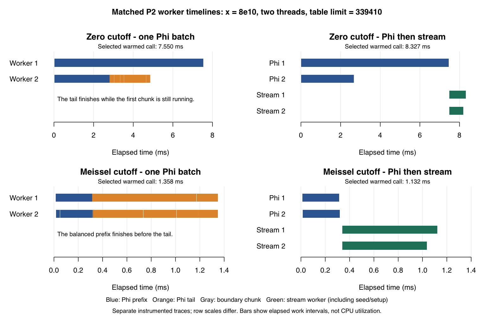

# Matched-cutoff P2 profile: why the same tail favors different choices

The warmed reversal is primarily a scheduling effect in these measured cases.
With zero cutoff, production's single dynamic Phi batch finishes the common
tail while one worker is still computing the first expensive 32-query chunk.
The hybrid introduces a barrier before streaming and loses that overlap.
With the Meissel cutoff, the prefix balances well, and streaming saves time.

Production remains unchanged at `8b43ed790435b22eb9ec02627379082fe7deb103`.
V1/v2/v3 and all previous experimental kernels and results are preserved. This
study adds only temporary diagnostics and controls; it does not retune a
selector or implement a different production scheduler.

## Matched work and measurement

Both cases use `x = 80000000000`, two threads, and
`L = floor(isqrt(x) * 6 / 5) = 339410`. Prime indices are one-based; ranges
below are half-open.

| Component | Zero cutoff | Meissel cutoff |
| --- | ---: | ---: |
| `a` | 0 | 590 |
| Phi prefix indices | `[1,1725)` | `[591,1725)` |
| Prefix queries | 1,724 | 1,134 |
| Common candidate tail | `[1725,20886)` | same |
| Tail queries / integer span | 19,161 / 5,089,103 | same |
| Direct-table suffix queries | 3,783 | same |

The candidate is the existing fixed16 hybrid, also selected by v2 here. V3
selects Phi-only. The two original first chunks differ greatly: zero starts
with quotients from `4e10` down to `610687022`; Meissel starts with quotients
from `18488560` down to `17402653`.

Separate builds collect:

- **Plain timings:** production Phi-only, fixed16 hybrid, a split-Phi control,
  isolated prefixes and isolated tails after controlled cache histories. The
  split control joins the prefix batch and starts another Phi batch for the
  tail. It includes the same direct-table suffix inside the timer.
- **Worker timelines:** elapsed start/end timestamps for each 32-query chunk,
  phase and worker, plus stream seed, construction and segment-fill subtimers.
- **Phi counters:** per-worker prefix/tail/seed evaluator and cache counts.
  These builds also have trace clocks; none of their times support performance
  comparisons.
- **Original binary controls:** the frozen production, fixed16, v2 and v3
  executables from the preceding study, without this instrumentation.

Plain timings use nine randomized blocks, each with a fresh process per
configuration and one first plus seven warmed calls. Each warmed process is
represented by its median; comparisons pair these values within a block.
The original controls form a separate nine-block cohort. Timeline probes use
five blocks with one first plus five warmed calls. Counters use two blocks
with one first plus two warmed calls. Raw samples are retained; no samples are
removed, and ranges are observed block ranges, not confidence intervals.

## Whole-call and barrier controls

The plain native timings below exclude table preparation and diagnostic
printing. Values are medians of process medians in milliseconds. First calls
start without an earlier Phi evaluation; warmed calls retain the process-wide
Phi cache and prepared tables.

| Cutoff | Strategy | First ms | Warmed ms |
| --- | --- | ---: | ---: |
| Zero | One Phi batch | 19.896 | 7.418 |
| Zero | Phi prefix, then stream | 21.049 | 8.154 |
| Zero | Phi prefix, then Phi tail | 22.872 | 8.358 |
| Meissel | One Phi batch | 5.047 | 1.362 |
| Meissel | Phi prefix, then stream | 2.357 | 1.103 |
| Meissel | Phi prefix, then Phi tail | 5.022 | 1.354 |

Paired warmed changes relative to the single Phi batch:

| Cutoff | Hybrid | Split-Phi control |
| --- | ---: | ---: |
| Zero | +9.89% (+8.22 to +14.75) | +14.43% (+12.39 to +15.98) |
| Meissel | -18.41% (-22.31 to -13.21) | +0.91% (-6.50 to +2.99) |

Positive means more time. Paired percentages need not equal ratios of the
displayed aggregate medians. Every matched block agrees on the hybrid
directions and the zero split-Phi penalty. The Meissel split-Phi difference is
small and mixed. At one thread, the hybrid improves both warmed cutoffs:
zero by 4.79% and Meissel by 23.13%, with every block agreeing. The serial
split-Phi differences are small and mixed.

The frozen original binaries independently reproduce the reversal: warmed
fixed16 versus production is +11.04% for zero and -18.52% for Meissel; v2 is
+11.67% and -17.04%, respectively. One fixed16 Meissel block reverses direction,
but all nine v2 Meissel blocks improve. V3, which selects Phi-only, stays close
to production at the medians. First-call original zero controls have mixed
directions, so their small first-call differences should not be treated as
uniform. Do not pair the original cohort against the separate plain cohort.

## Where the extra elapsed time comes from



The figure selects a warmed call nearest the median process, then nearest that
process's median. It is a measured illustration, not an idealized schedule or
the source of the uninstrumented timing figures. Both strategies share an axis
within each row; the rows have different scales.

In **all 30 zero-cutoff baseline traces** (five first and 25 warmed), every
chunk touching the tail finishes before the initial 32-query chunk finishes.
This includes the chunk straddling the prefix/tail boundary. The initial chunk
is also the last completed chunk in all 30. On warmed calls, the median of
process-median leads for pure-tail completion is about **2.70 ms**. The tail
does real work, but that work does not extend the measured critical path.

Meissel has no such overlap in any of its 30 traces. Its initial chunk takes
about 35 microseconds when warmed, and its two prefix workers finish close
together. In the hybrid, the median prefix-worker completion gap is **4.788 ms
for zero**, versus **4.833 microseconds for Meissel**. These are completion
gaps, not measured mutex contention or CPU utilization.

After joining the prefix, the hybrid spends another approximately 0.83–0.88 ms
in the stream phase. The earliest worker-start delay is about 12–15
microseconds, and the gap from the final worker's completion to the completed
join is about 9–10 microseconds. The non-table Phi seed is about 0.334
microseconds and stream construction about 0.75–1.25 microseconds. Each stream
worker performs 39 segment fills; cumulative fill times are about 566–623
microseconds per worker. Much of the newly exposed phase is actual sieve work,
not merely thread creation overhead. Overlapping worker costs and separately
aggregated medians must not be added to predict whole-call time.

The split-Phi control supports the barrier explanation, but changes two things:
it starts a second batch and resets chunk alignment at index 1725. The original
boundary chunks are `[1697,1729)` for zero and `[1711,1743)` for Meissel. Their
whole-chunk times cannot be divided exactly into prefix and tail costs. The
all-tail-completed-before-initial-chunk observation avoids that attribution
problem.

## What the Phi cache does and does not explain

Every warmed common Phi tail has exactly the same work across both cutoffs,
histories, one/two workers, modes and counter blocks:

| Counter | Warmed common Phi tail |
| --- | ---: |
| Public Phi calls | 19,161 |
| Evaluator entries | 387,836 |
| Expanded nodes | 23,426 |
| Direct suffix terms | 2,605,094 |
| Eligible cache lookups, all hits | 340,984 |
| Cache misses, stores, new pages | 0 |

The remaining expansions are cache-ineligible work. The warmed zero prefix is
much heavier than the Meissel prefix: 2,333,105 versus 142,343 evaluator entries,
194,178 versus 15,760 expansions, and 8,718,120 versus 464,256 direct suffix
terms. Warmed streaming uses one non-table Phi seed at two workers: 30 entries,
two expansions and 26 hits, without misses or allocations. A single stream
uses the prepared `pi(L)` value and needs no Phi seed.

Cache sharing matters on the **first** tail call. These controlled histories
run in fresh processes; the listed prefix is evaluated once before measuring
the tail. Conditioning results are independently checked and its time excluded.

| History before first tail | Phi-tail ms | Stream-tail ms | Phi-tail eligible misses |
| --- | ---: | ---: | ---: |
| None | 3.808 | 0.874 | about 295,635 |
| Meissel prefix | 3.521 | 0.882 | about 268,460 |
| Zero prefix | 2.295 | 0.880 | 134,173 |
| Earlier Phi tail | 1.055 | 0.891 | 0 |

The zero prefix also removes further page allocations in the first measured
tail; fresh and Meissel-prefix histories allocate 526 and 461 pages,
respectively. Cold parallel counters can vary because duplicate computations
are allowed. Counts represent evaluation events, not distinct keys; concurrent
whole-call prefix/tail attribution can move some work between those ranges.

After warming, isolated Phi tails take about 1.04–1.05 ms and streams about
0.82–0.83 ms across these histories. Streaming is locally cheaper in both
contexts. The zero whole-call regression arises because the existing scheduler
can hide the Phi tail, whereas the tested hybrid exposes its streaming cost.
Identical software-cache counters exclude different memoization misses or
evaluator work as the warmed-tail explanation. Hardware cache locality,
coherence, core placement and frequency were not measured.

## Implication and limits

These observations explain why stream density and worker-count parity were
insufficient. A useful model must account for how much tail work is already
hidden behind the prefix's slowest chunk. The next discussion should consider
whether to preserve that overlap or estimate the prefix imbalance. No new
scheduling algorithm or selector rule is implemented by this study. The strong
initial-chunk imbalance also merits discussion before attempting finer chunks;
smaller chunks have their own coordination and cache costs.

This is a focused native arm64 macOS study of one input/table pair and two
cutoffs, with serial controls. It supports the stated explanation for these
cases; it is not a general crossover formula or a universal scheduling result.
There is no full R package check or other-platform run because production and
the R interface are unchanged.

## Validation, retained evidence and reproduction

- All **2,880 uninstrumented timed results** (2,304 plain, 576 original controls)
  and **372 diagnostic results** (180 timelines, 192 counters) match independent
  references. Query ranges, trace bounds and per-phase counters are checked.
- Final plain/timeline/counts/ASan-UBSan/TSan validation checks **480 results**,
  including 384 trace-coverage and 288 counter-coverage checks. These are
  additional to the measured/probed results above.
- Separate Phi instrumentation checks pass **93,653 independent checks each**
  under ASan/UBSan and TSan, including TLS restoration, concurrent workers,
  cache boundaries and independent survivor counts. Builds have no warnings
  and sanitizer runs have no diagnostics.
- All 24,668 reference terms are independent: a Python sieve computes the
  24,078 terms from index 591 onward; the already installed primecount 8.0
  Gourdon C API computes the first 590. Stream seeds and component sums are
  independently verified. Both totals also agree with the preceding study.
- Plotting initially encountered missing X11 dependencies in R's Cairo device;
  the native Quartz bitmap device produced the verified figure without warnings.
  No dependency was installed, and this occurred after all measurements.

Sources are in [matched-profile](matched-profile). The readable
[analysis summary](results-matched-profile/analysis.txt), compressed raw
[plain timings](results-matched-profile/plain.jsonl.gz),
[original controls](results-matched-profile/controls.jsonl.gz),
[worker timelines](results-matched-profile/timeline.jsonl.gz) and
[counters](results-matched-profile/counts.jsonl.gz) are retained alongside
[references](results-matched-profile/references.json), build/run metadata,
independent audits and full aggregate analysis. The
[retention manifest](results-matched-profile/retention.json) records byte hashes.

The full artifact directory is
`/var/folders/fd/v2_r1ssx14jd6yww77jfvnmm0000gn/T/rcppalgos-p2-matched-7hxw_j7g`,
also recorded in `/tmp/rcppalgos-p2-matched-path`. For a fresh native run:

```sh
matched_dir=$(mktemp -d)
mkdir "$matched_dir/source" "$matched_dir/build"
git archive 8b43ed790435b22eb9ec02627379082fe7deb103 src inst/include | tar -x -C "$matched_dir/source"
cat /tmp/rcppalgos-p2-selector-v3-path > "$matched_dir/prior-artifact.txt"
python3 .github/development/p2-hybrid/matched-profile/reference_check.py "$matched_dir"
python3 .github/development/p2-hybrid/matched-profile/run.py build "$matched_dir"
python3 .github/development/p2-hybrid/matched-profile/run.py validate "$matched_dir"
python3 .github/development/p2-hybrid/matched-profile/run.py counts "$matched_dir"
python3 .github/development/p2-hybrid/matched-profile/run.py timeline "$matched_dir"
python3 .github/development/p2-hybrid/matched-profile/run.py timings "$matched_dir"
python3 .github/development/p2-hybrid/matched-profile/run.py controls "$matched_dir"
python3 .github/development/p2-hybrid/matched-profile/analyze.py "$matched_dir"
python3 .github/development/p2-hybrid/matched-profile/plot.py "$matched_dir"
```

Original controls require the preserved v3 artifact and binaries, reproducible
using that study's instructions. References use the existing primecount shared
library; plotting uses base R's macOS Quartz bitmap device. Kernels remain
C++11. Run compilation/validation separately from timings. Timed collectors
verify frozen build hashes and refuse to overwrite existing raw matrices.
Nothing was staged or committed.
