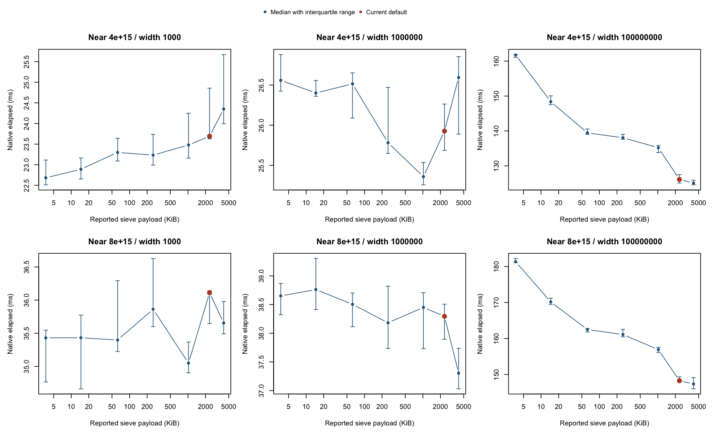

# Prime sieve inspector: measurements and recommendations

Recorded November 1, 2026, on an Apple M4. **Retain the current production
segment-size policy.** Neither finalist delivered a convincing balanced serial
improvement. Preparation costs and the interaction between segment size and
worker eligibility are more promising targets for the next investigation.

No production algorithm or sizing policy was changed during this measurement
task. The suite, raw observations, analysis, and this report are new developer
artifacts; the inspector implementation remains the previously prepared change.

The inspector is now preserved as a [developer-only toolkit](../prime-sieve-inspector/README.md)
that reconstructs it in a temporary package. Production sources have been
restored; the measurements below are unchanged, and source links point to the
corresponding uninstrumented code.

## What was tested

The suite completed successfully:

| Check | Coverage | Result |
|---|---|---|
| Existing focused tests | `testCacheInspector.R` and `testPrimeSieve.R` | Passed |
| Independent reference | 30 intervals, five budgets; aligned/crossing boundaries, prime-square endpoints, near `2^53 - 1` | All matched `isPrimeRcpp()` |
| R sizing/policy experiments | 879 measured calls, plus warmups; seven budgets, widths `1e3`, `1e6`, `1e8`, one/two/four requested workers | All full outputs matched ordinary serial `primeSieve()` |
| Cross-kernel controls | 3,600 measured ordinary/inspected calls across Small, Medium, Big; one/four requested workers | All full outputs matched |
| Native confirmation | 540 measured calls with worker instrumentation disabled; default and two finalists, one/four requested workers | All full outputs matched the ordinary native path |

The independent reference uses the separate primality implementation reached by
`isPrimeRcpp()` (`IsPrimeVec` in `src/PollardRhoDepends.cpp`), rather than another
segmented sieve. Wide-interval comparisons are differential checks, not independent
proof of primality. The first harness attempt overflowed an R integer while
constructing a prime square; converting the candidates to double before the
exact, supported-range multiplication fixed the harness. No package defect was
found by this suite.

The inspector's earlier build validation also included ASan/UBSan comparisons
and related caller tests, documented in [the inspector guide](../cache-inspector.md).
Those were not rerun as part of these release-speed measurements. This task did
not run a full `R CMD check`, a sanitizer build of every new workload, hardware
performance counters, or cross-platform benchmarks.

## Method and hardware

The installed development build was based on commit `0364f49`, with the
uncommitted inspector sources identified by hashes. R was 4.6.1, package version
2.10.3, macOS 15.7.4, ARM64. Native confirmation used Apple Clang 17, C++11,
`-O3`; its full command and source hashes are retained.

The host reports four performance and six efficiency cores. Per-cluster `sysctl`
values report 128 KiB/16 MiB L1-data/L2 for the performance cluster, and
64 KiB/4 MiB for the efficiency cluster; L2 is shared within each cluster. These
are OS topology reports, not measurements of cache behavior during the sieve.
There was no affinity or frequency locking, cache flushing, or thermal control.

R's normal policy saw ten physical cores and ten available threads. The tool
sandbox instead hid physical-core detection, causing a fallback to one; the R
experiments therefore ran outside it. Under the normal policy, serial Big begins
above approximately `3.958e15`, so the main sweep used `4e15` and `8e15`.
The `1e15` workloads separately examined Medium/Big dispatch and serial fallback.

Each configuration was warmed, then measured in randomized rounds. Screening
used seven observations per configuration; serial confirmation used fifteen on
shifted endpoints. Two finalists were selected by equally weighting the six
serial workloads with geometric means of median runtime ratios. This balances
magnitudes and widths; it is not a claim about the frequency of real user calls.
Every invocation generated its base primes afresh in a warm process.

The primary R sweep metric sums coarse C++ elapsed phases: base preparation,
policy/setup, worker execution, and R-result conversion. It excludes diagnostic
report construction. Full R-call time was also recorded, with roughly 1 ms timer
resolution. Native confirmation timed `PrimeSieveMain`, excluding R conversion
and parallel result concatenation. Compare configurations **within** each method;
their absolute timings represent different work. Medians and quartiles are
reported; no significance test or confidence interval was inferred.

## Findings

### 1. The existing default is competitive

The default serial Big flag payload on this host is about 2.29 MiB. The 4 MiB
budget was effectively tied overall; 1 MiB lost time on the wide cases.

| Configuration | Serial screening ratio | Shifted R confirmation ratio | Native confirmation ratio |
|---|---:|---:|---:|
| Default | 1.000 | 1.000 | 1.000 |
| 4 MiB | 1.000 | 0.996 | 0.996 |
| 1 MiB | 1.012 | 1.015 | 1.011 |

Ratios are equal-weight geometric means; below one is faster. The 4 MiB R
confirmation varied from about 2% faster to 2% slower across cases, while typical
within-case interquartile spreads were around 1–3%. Full R-call confirmation
put 4 MiB about 0.7% slower overall. These results do not justify replacing the
default. Disabling worker instrumentation preserved the broad conclusion.

The curves include the existing default in orange. They do not identify cache
boundaries. The [PDF](results-2026-11-01/serial-sizing.pdf) is also available.

### 2. A smaller sieve can create much larger bucket storage

For the serial interval near `4e15` with width `1e8`:

| Budget | Flag capacity | Bucket payload capacity | Bucket preparation | Total native elapsed |
|---|---:|---:|---:|---:|
| One wheel | 3.67 KiB | 52.03 MiB | 89.59 ms | 161.76 ms |
| Default | 2.29 MiB | 11.00 MiB | 38.56 ms | 126.11 ms |
| 4 MiB | 4.00 MiB | 6.25 MiB | 29.42 ms | 125.07 ms |

The smallest budget was 28.3% slower here and 22.3% slower at `8e15` over the
same width. This is not just a flag-array cache experiment: `PrimeSieveMain`
classifies primes using `2 * prime < segment span`, and `PrimeSieveBig` prepares
bucket strikes for the requested interval. Reducing the span moves more primes
into that scheduling path. See the split around
[Eratosthenes.cpp:808](../../../src/Eratosthenes.cpp#L808) and bucket preparation
around [line 494](../../../src/Eratosthenes.cpp#L494).

Larger segments also increase dense marking and can change extraction work.
Storage fields are vector capacities, not peak RSS or measured resident working
sets. The evidence supports a scheduling/storage tradeoff, not a cache-miss claim.

### 3. Segment size and useful parallelism are coupled

With the default policy and width `1e8`, requesting four workers activated four:

| Starting magnitude | One worker | Four workers | Elapsed reduction |
|---|---:|---:|---:|
| `4e15` | 128.51 ms | 77.30 ms | 39.8% |
| `8e15` | 150.30 ms | 92.64 ms | 38.4% |

These are within-stage medians from the R parallel experiment. In contrast,
fixed 1 MiB allowed only two workers, and fixed 4 MiB fell back to one. The
eligibility rule divides range width by four full segments
([Eratosthenes.cpp:843](../../../src/Eratosthenes.cpp#L843)). A “four-thread”
comparison of those budgets would compare different actual worker counts.

Native confirmation reproduced this: at `4e15`, width `1e8`, four requested
workers took 77.47 ms by default, 100.81 ms with 1 MiB, and 125.12 ms with 4 MiB.
This supports keeping default sizing for these parallel workloads.

At `1e15`, requesting one worker selected Medium; requesting two/four selected
Big even when short workloads subsequently fell back to one worker. Short-case
timing differences were only around 1–2% here. This is existing policy behavior,
not evidence of a defect. Kernel choice, span, and actual workers must all be
recorded when testing future changes.

### 4. Short intervals are dominated by preparation

At width `1e3`, default serial calls spent 13.87 of 23.69 ms near `4e15`, and
21.30 of 36.11 ms near `8e15`, generating base primes: approximately 59%.
Policy/setup added about 3.75/5.72 ms and bucket preparation 5.28/7.93 ms.
The actual dense marking was about 0.18 ms and extraction about 0.001 ms.
These are medians of individual phases, so they need not add exactly to the
median total. The repeated generation is visible at
[Eratosthenes.cpp:796](../../../src/Eratosthenes.cpp#L796).

Even an enormous speedup in extraction would have little effect on these short
calls. At width `1e8`, dense marking and bucket preparation instead dominate;
both workload classes deserve separate follow-up experiments.

### 5. The inspector is useful, but not free

Full-call controls showed about 0.2–0.3 ms extra cost in the short Medium case
(ordinary about 1.1 ms). Submillisecond Small comparisons were too coarsely
quantized for reliable percentage claims. On the longer controls, inspected
medians ranged from roughly 1% faster to 5% slower than ordinary calls; a faster
inspected result is consistent with measurement variability and does not
establish an improvement.

Ordinary calls do not assemble the diagnostic report. Use the inspector to
locate costs, then confirm promising candidates with worker instrumentation
disabled. Summed worker phase times overlap during parallel execution and must
not be interpreted as wall time or CPU time.

## Recommended next investigations, in order

1. **Examine preparation for short high intervals.** Measure base-prime generation,
   allocation, and copying separately, starting with changes confined to one
   invocation. Reusing prepared primes across calls is a possible later experiment,
   but persistent ownership, memory limits, and invalidation need discussion.
   The phase breakdown supports this target; it does not establish an achievable
   speedup.
2. **Separate the dense/bucket split from segment size experimentally.** Hold
   segment geometry and worker count fixed, vary only the split, and compare
   preparation plus marking and storage. The current sweep changes both at once.
   This is a focused way to test the largest wide-interval tradeoff before
   redesigning buckets or bit storage.
3. **Study dispatch and actual worker eligibility together.** Extend the grid
   around the Medium/Big cutoff and four-segments-per-worker threshold, measuring
   preparation duplication as well as elapsed time. Preserve current policy until
   a candidate wins across representative widths and more than one machine.

Further blind size sweeps or a new fixed cache-size constant are lower priority.
No recommended optimization was implemented as part of this report.

## Reproduction and evidence

[README.md](README.md) gives commands and explains each script. The recorded
directory contains [raw R runs](results-2026-11-01/runs.csv),
[median/quartile summaries](results-2026-11-01/summary.csv),
[independent checks](results-2026-11-01/correctness.csv),
[native confirmation](results-2026-11-01/native-confirmation.csv),
[control measurements](results-2026-11-01/controls.csv), and
[host metadata](results-2026-11-01/metadata.txt).
The conclusions are limited to this host, this build, these widths and alignments,
and a warm process. They do not establish the best size for other machines or
for Small/Medium kernels, whose segment sizes were not overridden.
